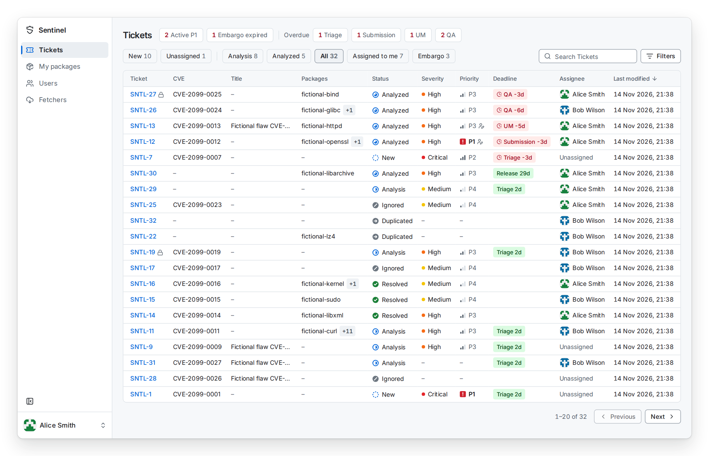
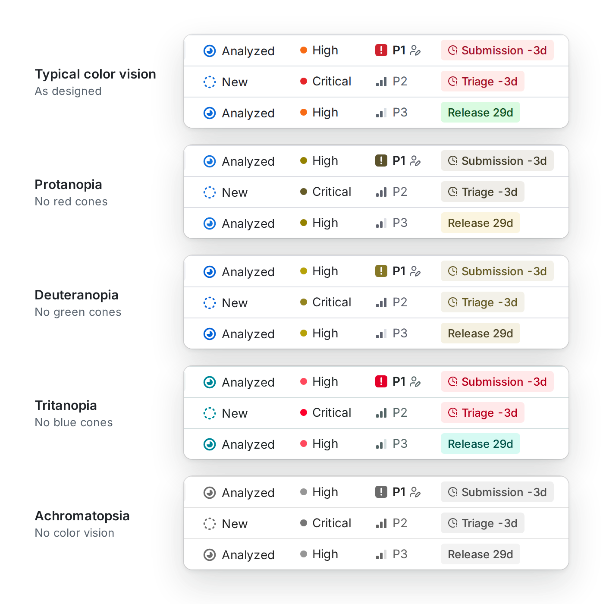
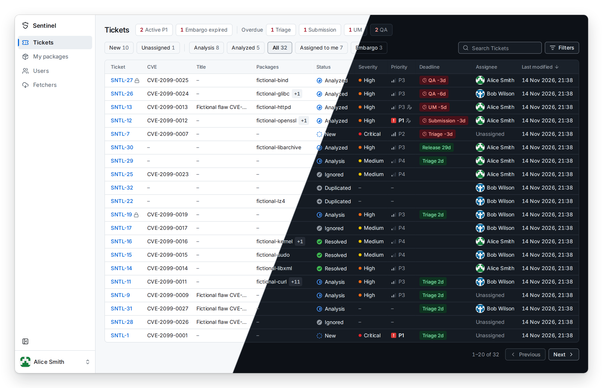
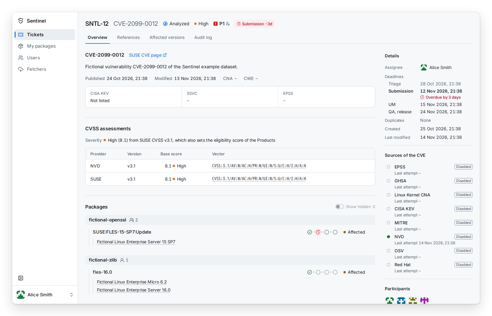
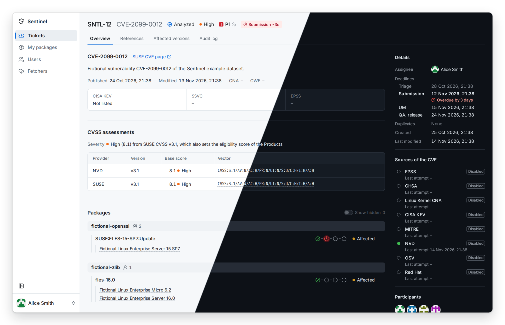

<picture>
<source media="(prefers-color-scheme: dark)" srcset=".github/assets/banner-b-dark.svg">

</picture>

Sentinel Aura is the web interface of
[Sentinel](https://github.com/vulnwatch/sentinel), the security update
management platform for SUSE and openSUSE-based Linux distributions. It brings
Sentinel's Tickets, with their CVEs, packages, and deadlines, to the browser,
for the people who work with them: the vulnerability analysts who triage and
follow their queues all day, the package maintainers who look for the fixes
that wait for them, and every colleague who needs SUSE's status for a CVE.

<picture>
<source media="(prefers-color-scheme: dark)" srcset=".github/assets/screenshot-ticket-list-dark.png">

</picture>
 
Fictional data from Sentinel's example dataset.

## Highlights

- **Accessible.** Designed to meet WCAG 2.2 at levels A and AA in both
  themes, and never to convey information by color alone
  ([Accessibility](#accessibility)).
- **Light and dark.** Follows the color scheme of the desktop, or the theme
  that each user chooses.
- **API only.** A static single-page application that reads and changes data
  only through Sentinel's REST API, on the same origin, with no server or data
  store of its own.
- **Pinned to the contract.** Every release is built and tested against one
  exact Sentinel version, with an API client generated from that version's
  OpenAPI document.
- **Hardened.** Served by an unprivileged nginx image, under a strict Content
  Security Policy that requires Trusted Types.
- **Verifiable.** Every release publishes its image with a CycloneDX SBOM and
  signed SLSA build provenance
  ([Verifying a Release](docs/deployment.md#verifying-a-release)).

## Accessibility

Sentinel Aura is designed to meet
[WCAG 2.2](https://www.w3.org/TR/WCAG22/) at levels A and AA, in the light and
the dark theme alike:

- **Checked on every change.** Every end-to-end test runs axe-core's WCAG 2.2
  A and AA rules on the screen it ends on, under the light and the dark color
  scheme, and fails on any violation; lint applies the accessibility rules of
  jsx-a11y to the code.
- **Contrast in both themes.** Every text has a contrast of at least 4.5:1,
  and every graphic needed to understand a screen at least 3:1, in each theme
  ([Contrast](docs/design-system.md#contrast)).
- **Never color alone.** A status, a severity, a priority, or a deadline
  always comes with a text or an icon, so it stays readable with any color
  vision.
- **Beyond automated checks.** Keyboard operation, focus, landmarks,
  announcements, reflow, and text resizing are requirements of every screen
  ([Accessibility](docs/behaviors.md#accessibility)).

<picture>
<source media="(prefers-color-scheme: dark)" srcset=".github/assets/color-vision-dark.png">

</picture>
 
Rows of the Ticket list with typical color vision and with four color vision deficiencies, simulated by Chromium.

## Technology

| Concern | Technology |
|---|---|
| Language | TypeScript |
| UI framework | React |
| Routing and server state | TanStack Router, TanStack Query |
| Accessible components | React Aria Components |
| Styling | Tailwind CSS |
| Build | Vite |
| Tests | Vitest in browser mode, Playwright, axe-core |
| Serving | nginx, in an unprivileged OCI image |

[Technology Stack](docs/architecture.md#technology-stack) records each choice,
the options considered, and the rationale.

## Documentation

| Document | Description |
|---|---|
| [Architecture](docs/architecture.md) | Scope, link to Sentinel's API contract, hosting constraints, and architecture decisions |
| [Screen Map](docs/screen-map.md) | Users and their tasks, screens and navigation, contract URLs, and roles |
| [Cross-Cutting Behaviors](docs/behaviors.md) | Session, preferences, errors, loading, dates, confirmations, accessibility, and wording |
| [Design System](docs/design-system.md) | Themes, colors and contrast, type, icons, layout, and interface patterns |
| [Screens](docs/screens/) | What each screen does, as built |
| [Conventions](docs/conventions.md) | Code, shell, Git, and specification-writing conventions |
| [Deployment](docs/deployment.md) | CI pipeline, dependency updates, release process, supported Sentinel versions, and release verification |

## Contributing

See [CONTRIBUTING.md](CONTRIBUTING.md) for the development setup, the checks,
and the pull request process. Bugs and features of the backend and of its API
belong to [Sentinel](https://github.com/vulnwatch/sentinel/issues).

## Specification Boundary

[Sentinel](https://github.com/vulnwatch/sentinel) owns the domain and API
contract specifications, including the obligations that its contracts place on
clients, such as session cookie handling, error handling by the `code` field,
tolerance of non-breaking API changes, and non-disclosure semantics.

This repository owns the UI and its specifications: navigation, screens,
presentation, and client-side behavior. The UI uses Sentinel only through its
API, as defined by the OpenAPI document published with each Sentinel release
and by Sentinel's specifications. UI specifications never define backend
behavior: a capability that the UI needs and the API lacks is specified and
implemented in Sentinel first.

Client-side behavior is specified only here. A Sentinel specification may
justify a backend decision by what a client can do through the API; that
justification is rationale of the contract and prescribes no presentation.

See the System Boundary section of Sentinel's
[architecture document](https://github.com/vulnwatch/sentinel/blob/master/docs/architecture.md#system-boundary).

## Security

Do not report vulnerabilities in public issues. See [SECURITY.md](SECURITY.md).

## Code of Conduct

This project follows the [Contributor Covenant](CODE_OF_CONDUCT.md).

## License

Licensed under the [Apache License 2.0](LICENSE).

---

## Candidates (temporary, removed before the pull request)

Switch the GitHub theme (Settings → Appearance) to see the light and the dark
version of each adaptive image.

### Banner A — Sentinel's shield and typography

<picture>
<source media="(prefers-color-scheme: dark)" srcset=".github/assets/banner-a-dark.svg">

</picture>

### Banner B — the Sentinel mark of the UI, in an aura (shown at the top)

<picture>
<source media="(prefers-color-scheme: dark)" srcset=".github/assets/banner-b-dark.svg">

</picture>

### Banner C — Sentinel's shield, in an aura

<picture>
<source media="(prefers-color-scheme: dark)" srcset=".github/assets/banner-c-dark.svg">

</picture>

### Main screenshot — Ticket list, diagonal

### Main screenshot — Ticket, adaptive

<picture>
<source media="(prefers-color-scheme: dark)" srcset=".github/assets/screenshot-ticket-dark.png">

</picture>

### Main screenshot — Ticket, diagonal

